# Bàn giao FE: Tích hợp Word Atlas vào CatSpeak

**Người thực hiện:** Huy (FE) · **Ngày:** 23/11/2026 · **Branch:** `feature/huy-practice-galaxy` (tách từ `feature/vocabulary-galaxy`)

Tài liệu này mô tả phần Frontend đã làm cho các task của Huy trong Sprint Backlog 48 PD. Nội dung gồm chức năng, ảnh giao diện, hợp đồng API cần BE xác nhận, cách bật/tắt, cách kiểm thử và các việc còn mở.

> Ghi chú phạm vi: UI dựng theo UX của word-atlas, dùng màu hiện tại của CatSpeak. Khi có theme mới chỉ cần sửa class gom trong [`components/ui.js`](../../../src/features/vocabulary-practice/components/ui.js).

---

## Mục lục

1. [Tóm tắt](#1-tóm-tắt)
2. [Màn hình chọn chế độ](#2-màn-hình-chọn-chế-độ-fe-02)
3. [Bốn chế độ ôn tập](#3-bốn-chế-độ-ôn-tập-fe-02)
4. [Tích hợp FSRS](#4-tích-hợp-fsrs-fe-05-s2)
5. [Nhắc ôn trong app](#5-nhắc-ôn-trong-app-fe-03)
6. [Galaxy: kết nối dữ liệu và tối ưu](#6-galaxy-kết-nối-dữ-liệu-và-tối-ưu-fe-07--fe-04)
7. [Đa ngôn ngữ, giao diện tối, mobile](#7-đa-ngôn-ngữ-giao-diện-tối-mobile)
8. [Hợp đồng API cần BE xác nhận](#8-hợp-đồng-api-cần-be-xác-nhận)
9. [Feature flag, deploy, rollback](#9-feature-flag-deploy-rollback-rel-01)
10. [Kiểm thử](#10-kiểm-thử-qa-s1--qa-s3)
11. [Cấu trúc code](#11-cấu-trúc-code)
12. [Việc còn mở và rủi ro](#12-việc-còn-mở-và-rủi-ro)

---

## 1. Tóm tắt

| Sprint | Task | Nội dung | Trạng thái FE |
| --- | --- | --- | --- |
| S1 | **FE-02** Bốn chế độ ôn tập | Gõ từ, Gõ câu, Nghe và điền, Flashcard; luồng trả lời và chuyển câu; chuẩn hoá chữ Hán/pinyin | ✅ Xong |
| S1 | **QA-S1** | Test 4 chế độ, nhập liệu, chuyển câu | ✅ Phần FE xong (test tự động) |
| S2 | **FE-05** Tích hợp FSRS | Gửi thời gian/gợi ý/nhãn chấm, hiện lịch ôn, phím tắt, hàng đợi offline | ✅ Xong phía FE, **chờ API BE-02** |
| S3 | **FE-04** Tối ưu Galaxy | Dừng vẽ khi tab ẩn/khuất, fallback WebGL2, Reduce Motion | ✅ Xong |
| S3 | **QA-S3** | Test Galaxy và API hỗ trợ | 🟡 Có test ánh xạ trạng thái; **chưa nghiệm thu với API staging** |
| S4 | **FE-07** Kết nối và hoàn thiện Galaxy | Dữ liệu thật, lối vào, mini Galaxy, đa ngôn ngữ | ✅ Xong, API gọn BE-05 nằm sau flag |
| S4 | **FE-03** UI nhắc ôn | Banner thẻ đến hạn, nút Ôn ngay, trạng thái quyền thông báo | ✅ Xong |
| S4 | **REL-01** | Feature flag, tài liệu, rollback | ✅ Phần FE xong; deploy staging chưa làm |

**Số liệu:** 52 file thay đổi, khoảng 2.600 dòng thêm. Toàn bộ test của repo pass (**472/472**, trong đó 42 test mới), lint sạch các file liên quan, `vite build` thành công.

### Cách chụp ảnh trong tài liệu

Ảnh được chụp từ app thật (`npm run dev`) bằng Playwright + Chrome. API được giả lập bằng 36 từ HSK mẫu chia 6 chủ đề, và phiên đăng nhập là giả. Vì vậy số liệu trong ảnh (12 thẻ đến hạn, lịch ôn...) là **dữ liệu mẫu**, không phải dữ liệu staging. Script chụp nằm ở [`tools/shoot-screens.mjs`](tools/shoot-screens.mjs) để QA chụp lại sau mỗi lần sửa UI (xem [mục 10](#chụp-lại-ảnh-giao-diện)).

---

## 2. Màn hình chọn chế độ (FE-02)

Route: **`/workspace/vocabulary-practice`**. Menu "Luyện tập từ vựng" nằm ở Workspace, chỉ hiện khi ngôn ngữ học là tiếng Trung (`zh`), giống mục Galaxy.

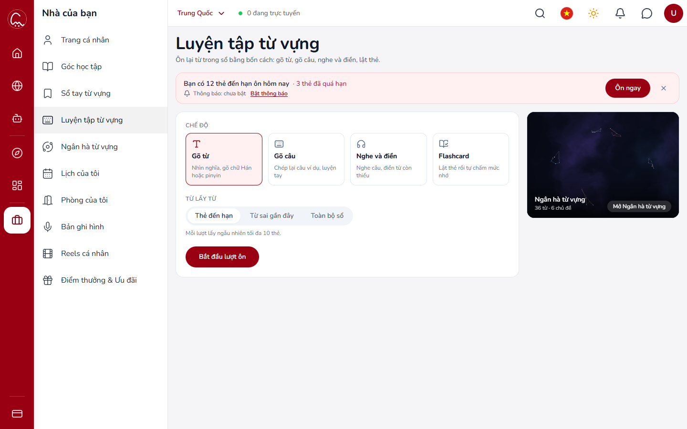

- **Chế độ:** 4 thẻ chọn, bố cục giống "Typing Studio" của word-atlas.
- **Nguồn từ:**
  - *Thẻ đến hạn*: deck `all` + `status=due`.
  - *Từ sai gần đây*: deck `recent-wrong`.
  - *Toàn bộ sổ*: deck `all`.
- **Một lượt ôn:** lấy tối đa 60 thẻ, lọc thẻ hợp với chế độ (ví dụ Gõ câu cần có câu ví dụ), rồi xáo ngẫu nhiên lấy **10 thẻ**.
- **Cột phải:** mini Galaxy, bấm vào mở trang Galaxy ([mục 6](#6-galaxy-kết-nối-dữ-liệu-và-tối-ưu-fe-07--fe-04)).
- **Phía trên:** banner nhắc ôn ([mục 5](#5-nhắc-ôn-trong-app-fe-03)).
- **Link sâu:** `?mode=word|sentence|listen|flashcard&source=due|recent-wrong|all&autostart=1`. Có `autostart=1` thì trang vào thẳng lượt ôn, sau đó tự xoá tham số khỏi URL để tải lại trang không mở thêm lượt mới. Tham số lạ thì dùng giá trị mặc định.

Dữ liệu thẻ đọc từ API sổ từ vựng có sẵn (`GET /v1/flashcards/decks/{id}/cards`), cùng schema với `CardBack` của ai-tutor, nên không cần API mới cho FE-02.

---

## 3. Bốn chế độ ôn tập (FE-02)

Phần chung của mọi chế độ:

- Thanh tiến độ "Thẻ i/n" và nút ✕ để thoát.
- Mỗi thẻ chỉ tính **lần trả lời đầu tiên**.
- Bấm "Tiếp tục" hai lần hoặc vừa tự chuyển vừa bấm tay đều **không bỏ sót thẻ** (đã có test).

### 3.1 Gõ từ: nhìn nghĩa, gõ chữ Hán hoặc pinyin

| Câu hỏi | Gợi ý (lần 1 hiện pinyin, các lần sau lộ dần từng chữ) |
| --- | --- |
| 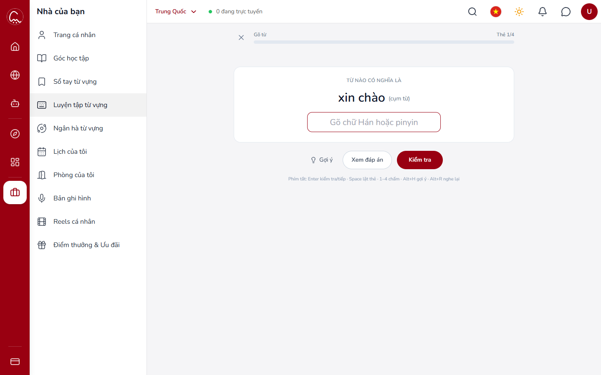 | 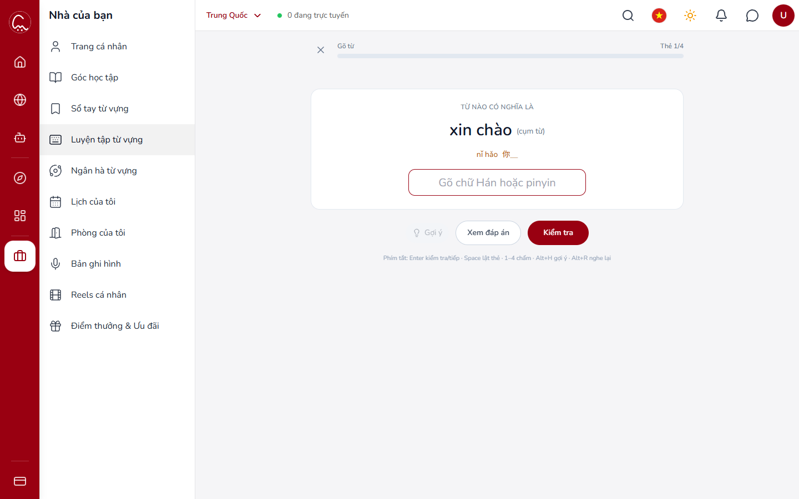 |

| Đúng → hiện thẻ + lịch ôn | Đúng chữ, sai thanh → "partial" | Sai → hiện đáp án |
| --- | --- | --- |
| 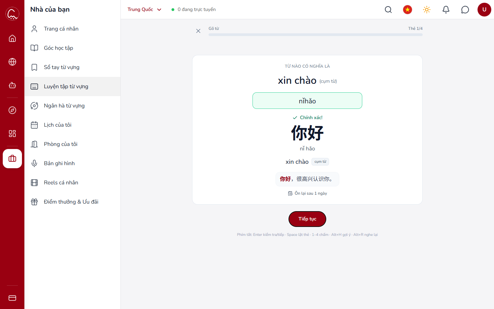 | 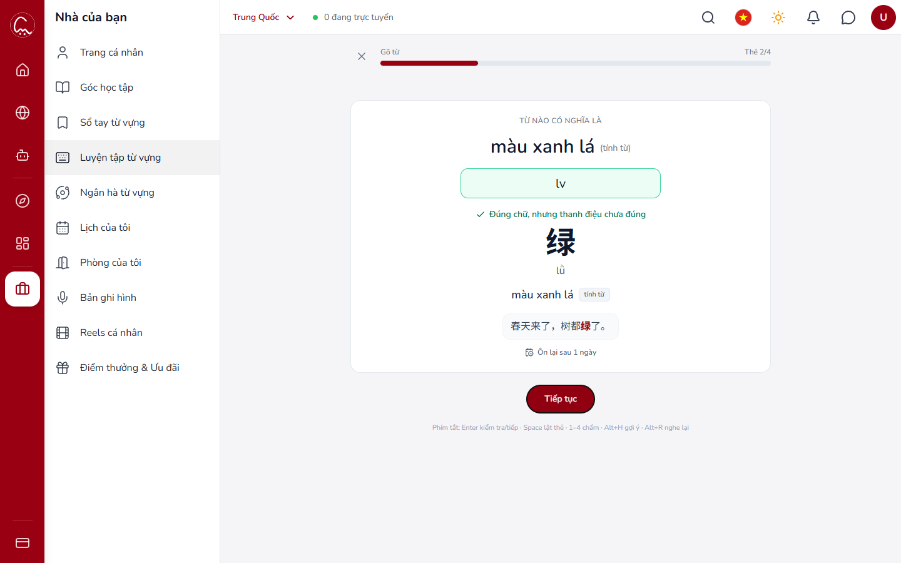 | 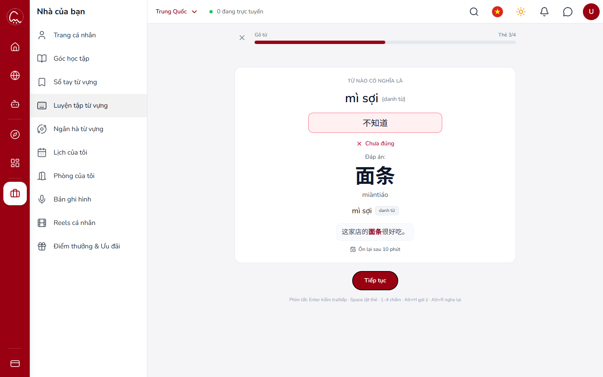 |

Quy tắc chấm đáp án ([`practiceText.js`](../../../src/features/vocabulary-practice/utils/practiceText.js)):

| Học viên gõ | Ví dụ (đáp án 你好 / nǐ hǎo) | Kết quả |
| --- | --- | --- |
| Chữ Hán đúng; bỏ qua dấu câu, khoảng trắng, ký tự toàn/nửa khổ | `你好`, ` 你好。` | correct |
| Pinyin có dấu thanh | `nǐhǎo`, `Nǐ Hǎo` | correct |
| Pinyin có số thanh | `ni3hao3`, `ni3 hao3` | correct |
| `v` hoặc `u:` thay cho `ü` | `lv4`, `lu:4` = `lǜ` | correct |
| Thanh nhẹ: không dấu, `5` hoặc `0` đều được | `ma1ma`, `ma1ma5` = `māma` | correct |
| Đúng mặt chữ nhưng thiếu hoặc sai thanh | `nihao`, `ni2hao3` | **partial** (tính là nhớ, nhưng chấm Hard) |
| Sai mặt chữ | `nihau`; `lu` cho 绿 (lǜ), vì `lu` là âm tiết khác (路, 鹿) | wrong |
| Để trống | | blank (tính sai) |

- Bộ gõ tiếng Trung: khi IME đang soạn chữ (`isComposing`), phím Enter không nộp bài.
- Thẻ không có pinyin thì chỉ nhận đáp án bằng chữ Hán.

### 3.2 Gõ câu: chép lại câu ví dụ

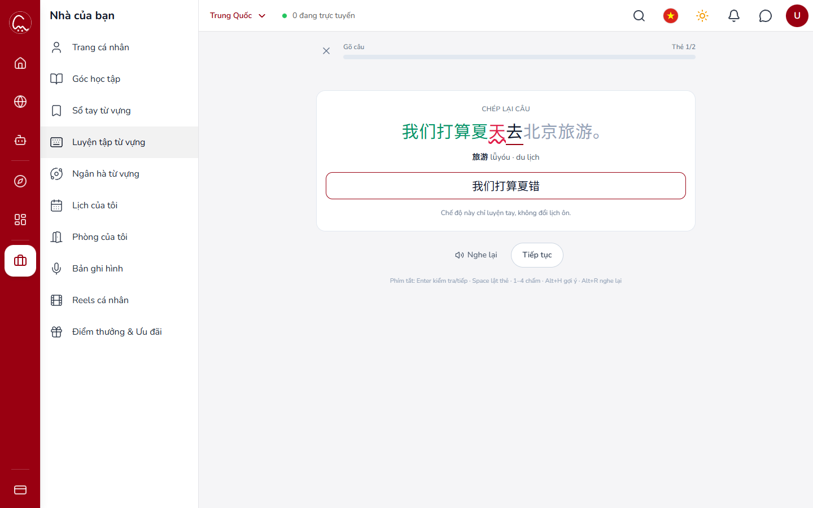

- Tô màu từng chữ như Typing Studio của word-atlas: xanh là đúng, đỏ gạch sóng là sai, gạch chân là vị trí đang gõ, xám là chưa gõ.
- **Không bắt gõ dấu câu**, và dấu câu nửa khổ học viên tự gõ cũng được chấp nhận.
- **Chỉ so phần chữ đã chốt của IME.** Chữ pinyin đang soạn (ví dụ `ni` trước khi chọn 你) không bị tô đỏ.
- Gõ đúng hết thì sau 0,7 giây tự sang thẻ tiếp.
- Đây là bài **luyện tay**, nên **không gửi nhãn FSRS**, giống quy ước của word-atlas. Giao diện có ghi chú điều này cho học viên.

### 3.3 Nghe và điền

| Câu hỏi | Điền đúng |
| --- | --- |
| 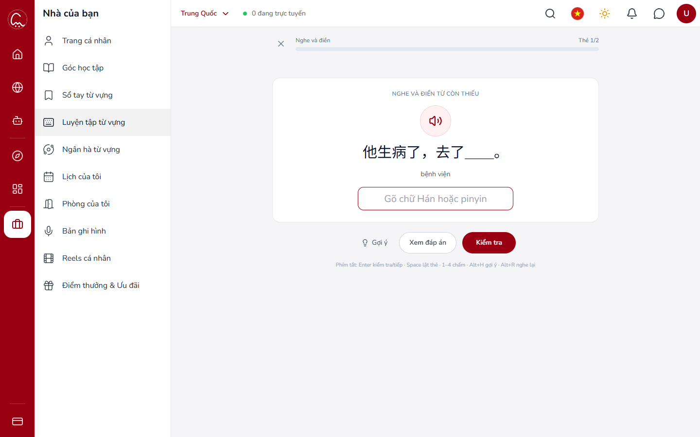 | 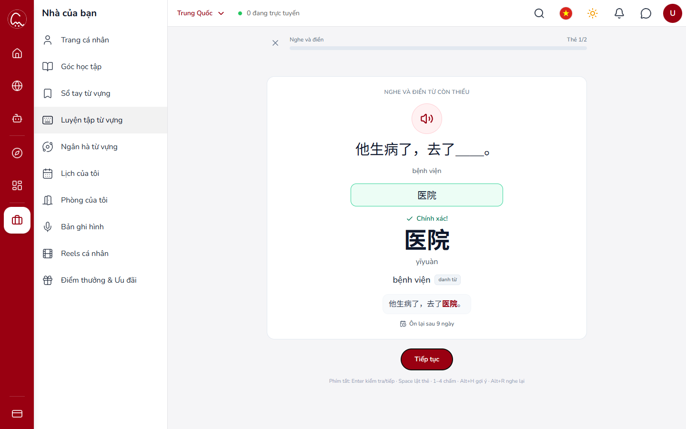 |

- Câu hỏi tự phát âm khi hiện, có nút loa để nghe lại (phím `Alt+R`).
- Âm thanh:
  - Ưu tiên `example_audio_url` (BE-06). Chưa có thì đọc câu bằng `speechSynthesis` của trình duyệt (zh-CN).
  - Câu không chứa từ cần điền thì chuyển sang nghe từ rồi gõ lại từ, dùng `audio_url` có sẵn.
- Chỗ trống: dùng `example_blank` nếu server trả, nếu không FE tự khoét từ ra khỏi câu.
- Nhận đáp án bằng chữ Hán hoặc pinyin, cùng quy tắc với Gõ từ. Bấm "Xem đáp án" thì chấm Again.

### 3.4 Flashcard

| Mặt trước | Mặt sau + chấm 1–4 |
| --- | --- |
| 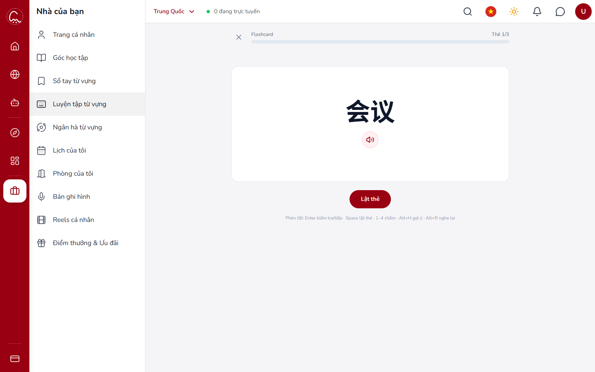 | 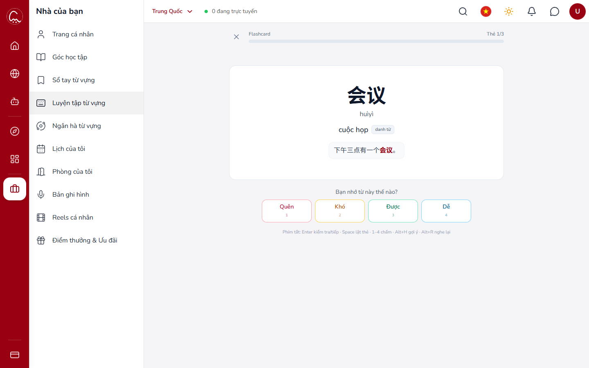 |

- `Space` (hoặc bấm vào thẻ) để lật. Thời gian trả lời tính từ lúc hiện thẻ đến lúc lật.
- Chấm bằng **Quên / Khó / Được / Dễ** (phím `1–4`, `Enter` = Được). Chấm xong sang thẻ ngay.
- Lịch ôn của thẻ vừa chấm hiện ở thanh trên, ví dụ "会议 · Ôn lại sau 3 ngày":

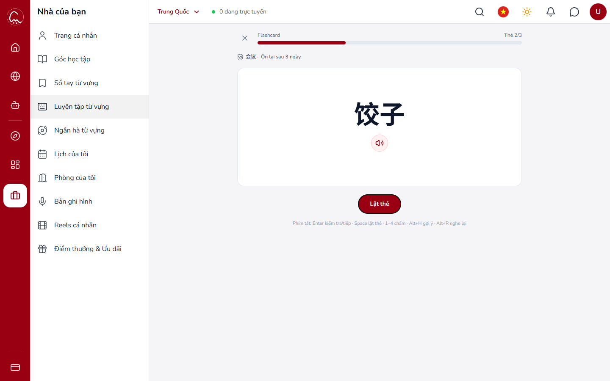

### 3.5 Màn tổng kết

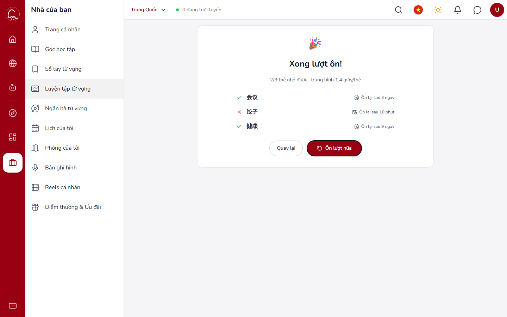

Màn tổng kết hiện:
- Số thẻ nhớ được.
- Thời gian trả lời trung bình mỗi thẻ.
- Số lần dùng gợi ý.
- Lịch ôn tiếp theo của từng thẻ.

Có 2 nút: "Ôn lượt nữa" (cùng chế độ) và "Quay lại".

---

## 4. Tích hợp FSRS (FE-05 S2)

### 4.1 Tín hiệu gửi lên

Hook [`usePracticeSignals`](../../../src/features/vocabulary-practice/hooks/usePracticeSignals.js) thu thập:

- **`elapsed_ms`**: thời gian trả lời, **trừ khoảng thời gian tab bị ẩn**, chặn trần 2 phút để một thẻ bị bỏ dở không làm lệch FSRS.
- **`hints_used`**: số lần bấm gợi ý.

### 4.2 Đổi tín hiệu sang nhãn FSRS

Logic nằm trong [`gradeFor`](../../../src/features/vocabulary-practice/utils/practiceModes.js), dựa theo `gradeFor` của word-atlas:

| Điều kiện | Nhãn |
| --- | --- |
| Sai, để trống hoặc bấm "Xem đáp án" | 1 · Again |
| Đúng nhưng dùng gợi ý, hoặc pinyin sai thanh | 2 · Hard |
| Đúng nhưng chậm (Gõ từ > 20s, Nghe > 25s) | 2 · Hard |
| Đúng, tốc độ vừa | 3 · Good |
| Đúng và nhanh (Gõ từ < 5s, Nghe < 6s) | 4 · Easy |
| Flashcard | Học viên tự chọn 1–4 |
| Gõ câu | Không gửi |

> Ngưỡng nhanh/chậm là **giá trị khởi đầu**. Nên chỉnh lại sau khi có dữ liệu thật.

### 4.3 Hiển thị lịch ôn

Sau khi server trả `due_at` (hoặc `scheduled_days`), giao diện hiện "Ôn lại sau 10 phút / 1 ngày / 3 ngày…". Đơn vị thời gian được định dạng theo ngôn ngữ giao diện bằng `Intl.NumberFormat`.

### 4.4 Hàng đợi offline

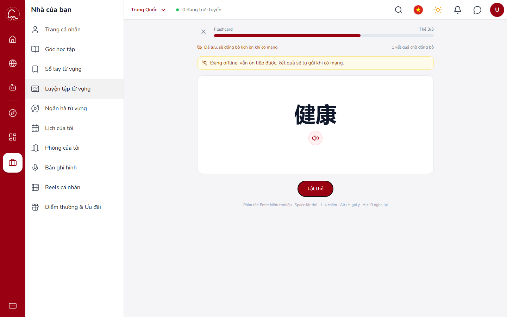

Mỗi lần chấm được **ghi vào localStorage trước** (`catspeak.practice.pendingGrades.v1`), sau đó mới gửi lên server:

- **Mất mạng:** banner vàng báo "Đang offline", học viên vẫn ôn tiếp; thẻ vừa chấm hiện "Đã lưu, sẽ đồng bộ…" kèm số kết quả đang chờ.
- **Có mạng lại:** gửi bù đúng thứ tự. Ở ảnh tổng kết phía trên, thẻ 饺子 được chấm lúc offline và sau đó vẫn nhận được lịch ôn.
- **Gửi lặp:** mỗi lần chấm có một `client_review_id` (uuid), nên server có thể bỏ qua bản gửi trùng.
- **Thử lại hay bỏ:** lỗi mạng, 5xx, 401, 408, 429 thì thử lại với backoff 2s → 4s → … tối đa 30s. Các lỗi 4xx khác thì bỏ mục đó để hàng đợi không bị kẹt.
- **Tái sử dụng:** dùng chung `flushQueue`, `nextBackoff` và trạng thái mạng của hàng đợi sổ từ vựng (ai-tutor), không viết lại logic.
- **Flag:** khi `VITE_FF_PRACTICE_FSRS` tắt, FE không gửi gì và Practice chạy như bài luyện tay. Đầu lượt ôn có dòng thông báo cho học viên biết.

### 4.5 Phím tắt

| Phím | Tác dụng |
| --- | --- |
| `Enter` | Kiểm tra / Tiếp tục (Flashcard: lật, hoặc chấm Được) |
| `Space` | Lật thẻ |
| `1` `2` `3` `4` | Quên / Khó / Được / Dễ |
| `Alt+H` | Gợi ý (dùng được cả khi đang gõ trong ô nhập) |
| `Alt+R` | Nghe lại |

Khi con trỏ đang ở ô nhập, chỉ nhận tổ hợp có `Alt`, để không nuốt chữ học viên đang gõ. Phím tắt cũng bị bỏ qua khi IME đang soạn chữ.

---

## 5. Nhắc ôn trong app (FE-03)

Component [`DueReminderBanner`](../../../src/features/vocabulary-practice/components/DueReminderBanner.jsx) được gắn ở **trang Practice** và **trang Galaxy**.


- **Số thẻ:** "Bạn có N thẻ đến hạn ôn hôm nay · M thẻ đã quá hạn", lấy từ `due_today_count` và `overdue_count` của `GET /v1/flashcards/home` có sẵn.
- **Nút "Ôn ngay":** mở `/workspace/vocabulary-practice?mode=flashcard&source=due&autostart=1`, vào thẳng lượt Flashcard với các thẻ đến hạn. Nút cũng chạy được khi học viên đang đứng ngay trên trang Practice.
- **Trạng thái quyền thông báo:** đã bật, bị chặn, chưa bật (có nút "Bật thông báo" gọi `Notification.requestPermission`), hoặc trình duyệt không hỗ trợ.
- **Nút ✕:** ẩn banner đến hết ngày, tính theo giờ máy của học viên.
- **Ẩn tự động:** banner không hiện khi không có thẻ đến hạn.
- **Ngoài scope:** Web Push khi trình duyệt đã đóng. Phần cài đặt giờ yên lặng, ngưỡng và giới hạn nhắc là API BE-04, chưa có UI.

---

## 6. Galaxy: kết nối dữ liệu và tối ưu (FE-07 + FE-04)

Phần nền WebGL (FE-01) do Nhi làm trên `feature/vocabulary-galaxy`. Phần Huy làm thêm:

| Trang Galaxy (có lối vào Practice + banner) | Rê chuột vào sao: Quick Flashcard, trạng thái đã dịch |
| --- | --- |
| 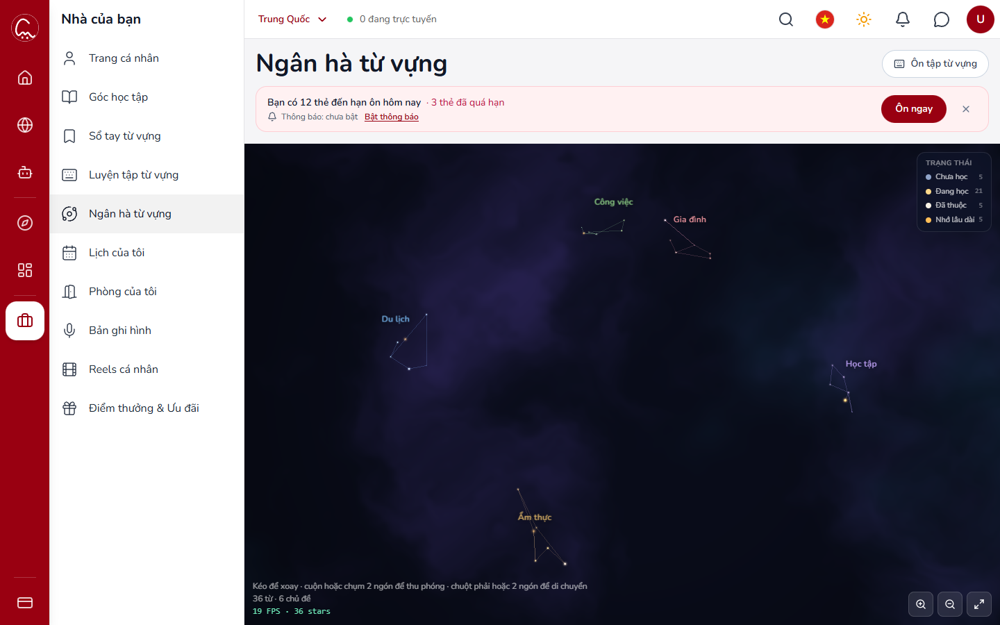 | 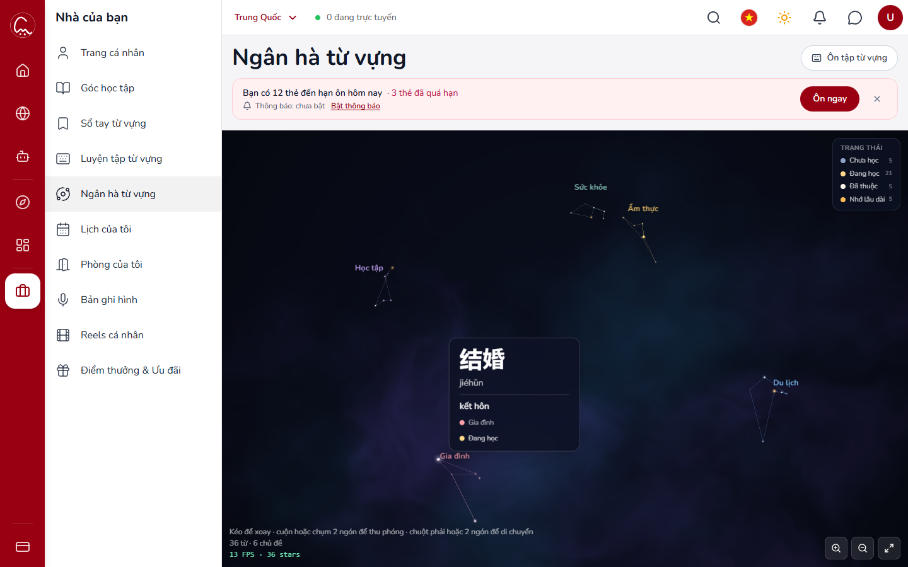 |

### 6.1 FE-07: kết nối và hoàn thiện

- **Sửa lỗi có sẵn: sao không sáng theo trạng thái học.** Hook lấy dữ liệu thật trước đây không gán `aState`, nên với dữ liệu thật mọi sao đều hiện "Chưa học". Giờ dùng `toGalaxyState()` ([`galaxyState.js`](../../../src/features/vocabulary-galaxy/core/galaxyState.js)), đọc được cả trường cũ lẫn trường FSRS:

  | Điều kiện | Mức sao |
  | --- | --- |
  | `galaxy_state` 0..3 do server tính sẵn | Dùng luôn |
  | `is_long_term`, hoặc FSRS Review + `stability` ≥ 21 ngày | 3 · Nhớ lâu dài |
  | `is_known`, hoặc FSRS Review | 2 · Đã thuộc |
  | Đã ôn ít nhất 1 lần (`reps`/`review_count`/`last_reviewed_at`), hoặc FSRS Learning/Relearning | 1 · Đang học |
  | Còn lại | 0 · Chưa học |

  Ngưỡng 21 ngày giống `MASTERED_STABILITY` của word-atlas.
- **API Galaxy gọn (BE-05)** nằm sau flag `VITE_FF_GALAXY_API`. Flag tắt thì vẫn gom từ các deck như cũ. Server trả ETag thì trình duyệt tự gửi `If-None-Match` qua HTTP cache, FE không cần code thêm.
- **Lối vào:**
  - Menu "Ngân hà từ vựng".
  - Nút "Ôn tập từ vựng" trên trang Galaxy để sang Practice.
  - Mini Galaxy trên trang Practice để sang Galaxy.
- **Mini Galaxy** ([`MiniGalaxy.jsx`](../../../src/features/vocabulary-galaxy/components/MiniGalaxy.jsx)):
  - Bản thu nhỏ, không có điều khiển, không có nhãn cụm, legend hay nút zoom.
  - Bấm vào thì mở trang Galaxy.
  - Dùng chung cache dữ liệu với trang lớn.
- **Đa ngôn ngữ:** nhãn 4 trạng thái (legend, tooltip) trước đây cứng tiếng Việt, giờ dịch theo vi/en/zh/ja.

### 6.2 FE-04: tối ưu cơ bản

Thay đổi nằm ở [`useGalaxyEngine.js`](../../../src/features/vocabulary-galaxy/hooks/useGalaxyEngine.js) và [`GalaxyRenderer.js`](../../../src/features/vocabulary-galaxy/core/GalaxyRenderer.js).

- **Dừng vẽ** khi tab ẩn (`visibilitychange`) **và** khi canvas bị cuộn khuất (`IntersectionObserver`). Trường hợp thứ hai quan trọng cho mini Galaxy, vì `requestAnimationFrame` không tự dừng khi canvas bị cuộn khuất. Khi vẽ lại, `dt` được reset để camera không nhảy.
- **Reduce Motion:** đổi trong hệ điều hành là có tác dụng ngay, không cần tải lại trang; sao ngừng tự xoay và tắt hiệu ứng nhấp nháy.
- **Mất WebGL context** (GPU reset, tab nằm nền lâu): dừng vẽ, chờ `webglcontextrestored` rồi dựng lại renderer. Trạng thái sao được giữ nguyên.
- **Sửa lỗi có sẵn ở fallback Canvas 2D:** `setStates()` chỉ cập nhật GPU, nên máy không có WebGL2 không thấy sao sáng lên sau khi học. Giờ chế độ 2D cũng cập nhật.

> FPS trong ảnh (13–19) thấp là do môi trường chụp ảnh không có GPU (SwiftShader render bằng CPU), **không phản ánh hiệu năng thật**. Ngưỡng FPS để nghiệm thu cần đo trên máy thật (xem [mục 12](#12-việc-còn-mở-và-rủi-ro)).

---

## 7. Đa ngôn ngữ, giao diện tối, mobile

Toàn bộ chữ trên giao diện nằm trong `vocabulary-practice/i18n/{vi,en,zh,ja}.js`. Khoá nào thiếu thì lấy bản tiếng Việt.

| Tiếng Anh | Giao diện tối |
| --- | --- |
| 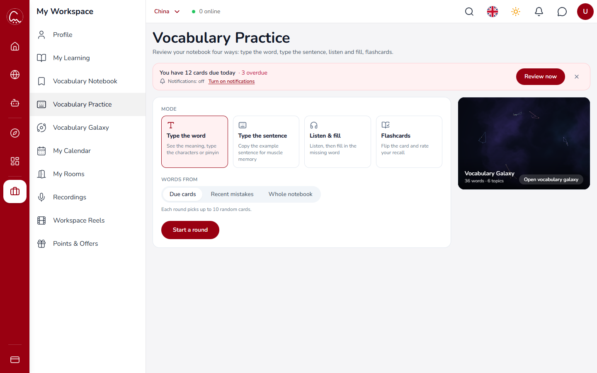 | 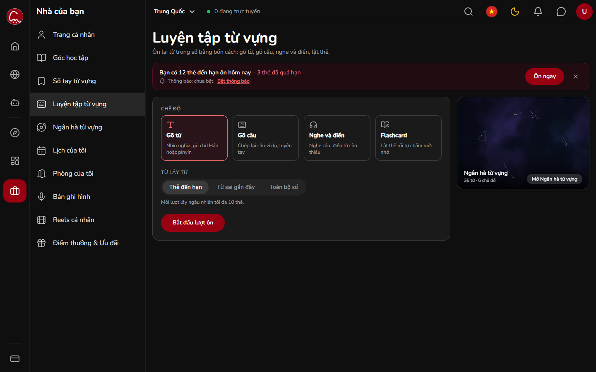 |

| Flashcard ở giao diện tối | Mobile: chọn chế độ | Mobile: gõ `ni3hao3` |
| --- | --- | --- |
| 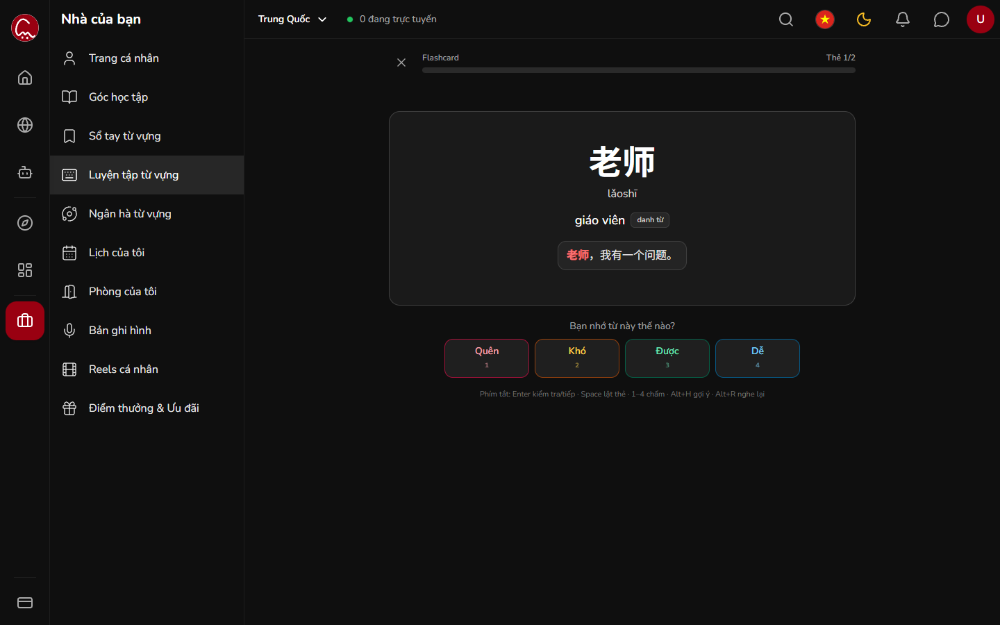 | 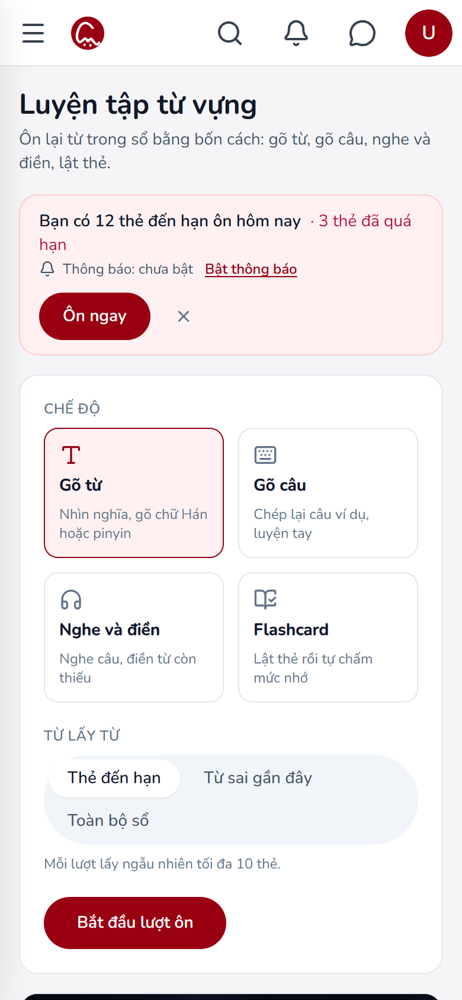 | 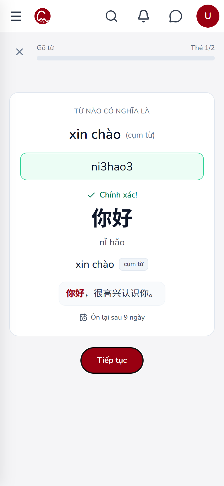 |

Mọi component đều có class `dark:` (theo yêu cầu trong `AGENTS.md`). Trên màn hình hẹp, 4 thẻ chế độ chuyển sang lưới 2×2 và banner nhắc ôn xuống dòng.

---

## 8. Hợp đồng API cần BE xác nhận

> ⚠️ Các endpoint dưới đây do FE **đề xuất**, BE chưa xác nhận. Nếu BE đổi tên trường, FE chỉ cần sửa 1 file cho mỗi API: [`practiceApi.js`](../../../src/features/vocabulary-practice/api/practiceApi.js) và [`galaxyApi.js`](../../../src/features/vocabulary-galaxy/api/galaxyApi.js).

### BE-02: chấm thẻ FSRS

```
POST /v1/flashcards/cards/{card_id}/grade
```
```json
{
  "client_review_id": "8f1c2e0a-…",
  "rating": 3,
  "mode": "word",
  "is_correct": true,
  "elapsed_ms": 4200,
  "hints_used": 0,
  "reviewed_at": "2026-11-23T09:00:00.000Z"
}
```
```json
{ "card_id": 12, "due_at": "2026-11-26T09:00:00Z", "scheduled_days": 3, "state": 2, "stability": 3.1 }
```

Yêu cầu với BE:
1. **Idempotent theo `client_review_id`.** FE sẽ gửi lại sau khi mất mạng, gặp 5xx, 401, 408 hoặc 429.
2. **Lịch ôn tính theo `reviewed_at`**, không theo giờ server nhận request, vì kết quả chấm lúc offline có thể đến muộn hàng giờ.
3. **Mã lỗi:** dùng 4xx (khác 401/408/429) cho lỗi vĩnh viễn như thẻ đã xoá hoặc không thuộc user. FE sẽ bỏ các mục này khỏi hàng đợi.
4. **Phân quyền:** chỉ chấm thẻ của chính user (cách ly dữ liệu theo QA-S2).
5. `mode` hiện có 3 giá trị `word`, `listen`, `flashcard`. Chế độ `sentence` không bao giờ gửi.

### BE-05: dữ liệu Galaxy gọn

```
GET /v1/flashcards/galaxy        (trả kèm ETag)
```
```json
{
  "clusters": [{ "id": "food", "label": "Ẩm thực", "color": "#f2c46d" }],
  "words": [{ "id": "123", "word": "米饭", "pinyin": "mǐfàn", "meaning": "cơm",
              "cluster_id": "food", "galaxy_state": 1 }]
}
```
- `color` không bắt buộc; thiếu thì FE tự chọn từ bảng màu.
- Nếu chưa tính `galaxy_state`, BE có thể trả `fsrs_state` + `stability` và FE tự đổi sang mức sao.
- Không trả definition hay audio trong payload này, đúng ghi chú của BE-05.
- FE giới hạn hiển thị 3.000 sao (`MAX_WORDS`). Muốn hiện 10.000 từ như kế hoạch kiểm tra tải của BE-05 thì cần đo FPS rồi nâng giới hạn này.

### BE-06: không bắt buộc, giúp chế độ Nghe và điền tốt hơn

Thêm 2 trường vào mỗi thẻ:
- `example_audio_url`: file đọc câu ví dụ.
- `example_blank`: câu đã khoét sẵn chỗ trống.

Thiếu thì FE vẫn chạy bằng `speechSynthesis` và tự khoét từ. Chất lượng giọng đọc khi đó phụ thuộc trình duyệt; một số trình duyệt không có giọng tiếng Trung.

### FE-03

Dùng `due_today_count`, `overdue_count` có sẵn trong `GET /v1/flashcards/home`, **không cần API mới**.

---

## 9. Feature flag, deploy, rollback (REL-01)

Flag đọc ở [`src/shared/config/featureFlags.js`](../../../src/shared/config/featureFlags.js), giá trị lấy lúc build. `1`/`true` là bật, `0`/`false` là tắt.

| Biến | Khi không đặt (dev) | Khi không đặt (build) | Bật thì có gì |
| --- | --- | --- | --- |
| `VITE_FF_VOCAB_PRACTICE` | bật | **tắt** | Route + menu Practice, banner nhắc ôn |
| `VITE_FF_PRACTICE_FSRS` | tắt | **tắt** | Gửi nhãn chấm lên BE-02 |
| `VITE_FF_VOCAB_GALAXY` | bật | **tắt** | Route + menu Galaxy, mini Galaxy |
| `VITE_FF_GALAXY_API` | tắt | **tắt** | Đọc Galaxy từ BE-05 thay vì gom từ các deck |

> Lưu ý: route Galaxy trên branch `feature/vocabulary-galaxy` trước đây không có flag. Sau khi merge branch này, **bản build sẽ ẩn Galaxy cho đến khi bật `VITE_FF_VOCAB_GALAXY=1`**.

### Deploy staging

1. Merge `feature/vocabulary-galaxy`, rồi merge `feature/huy-practice-galaxy` vào `staging`.
2. Đặt biến môi trường staging: `VITE_FF_VOCAB_PRACTICE=1`, `VITE_FF_VOCAB_GALAXY=1`.
3. Khi BE-02 lên staging thì bật thêm `VITE_FF_PRACTICE_FSRS=1`. Khi BE-05 lên staging thì bật thêm `VITE_FF_GALAXY_API=1`.
4. Build và deploy, sau đó chạy checklist ở [mục 10.2](#102-checklist-kiểm-thử-tay-sau-deploy-staging).

### Rollback

| Tình huống | Cách xử lý |
| --- | --- |
| Lỗi chỉ ở phần FSRS | Tắt `VITE_FF_PRACTICE_FSRS`. Practice vẫn dùng được như bài luyện tay |
| Lỗi API Galaxy | Tắt `VITE_FF_GALAXY_API`. Galaxy quay lại gom từ các deck |
| Lỗi Practice hoặc Galaxy nói chung | Tắt flag tương ứng rồi build lại. Route và menu biến mất, không cần revert code |
| Cần gỡ hẳn | Revert merge commit |

Khi tắt flag, các nhãn chấm đang chờ vẫn nằm trong localStorage và sẽ được gửi tiếp khi bật lại. Nếu không muốn giữ thì xoá khoá `catspeak.practice.pendingGrades.v1`.

---

## 10. Kiểm thử (QA-S1 / QA-S3)

### 10.1 Test tự động

Chạy bằng `npx vitest run src/features/vocabulary-practice src/features/vocabulary-galaxy`.

| File | Nội dung | Số test |
| --- | --- | --- |
| `utils/practiceText.test.js` | Chuẩn hoá pinyin (dấu/số/ü/thanh nhẹ), chấm chữ Hán/pinyin, so từng chữ khi gõ câu, khoét chỗ trống | 17 |
| `utils/practiceModes.test.js` | Quy tắc nhãn FSRS, điều kiện thẻ hợp chế độ, định dạng khoảng thời gian, link sâu | 10 |
| `utils/gradeQueue.test.js` | Hàng đợi sống qua tải lại trang, chống ghi trùng, mất mạng giữa chừng rồi gửi bù đúng thứ tự, lỗi 4xx bị bỏ, không có localStorage | 5 |
| `components/PracticeRound.test.jsx` | Luồng của cả 4 chế độ, dùng gợi ý thì chấm Hard, bấm đúp không nhảy cóc, phím Space/1–4, Gõ câu không gửi FSRS, tắt flag | 6 |
| `vocabulary-galaxy/core/galaxyState.test.js` | Ánh xạ trạng thái (trường cũ, FSRS, giá trị server tính sẵn) | 4 |

Kết quả: toàn bộ repo **76 file, 472 test pass**.

### 10.2 Checklist kiểm thử tay sau deploy staging

**Practice**
- [ ] Menu Workspace (ngôn ngữ học `zh`) có "Luyện tập từ vựng" và "Ngân hà từ vựng".
- [ ] Cả 4 chế độ chạy được với 3 nguồn thẻ. Nguồn không có thẻ phù hợp thì hiện thông báo, không bị trắng trang.
- [ ] Gõ từ nhận `ni3hao3`, `nǐhǎo`, `你好`. `nihao` cho kết quả "thanh điệu chưa đúng".
- [ ] Gõ bằng bộ gõ tiếng Trung thật (Windows, macOS, mobile): Enter để chọn chữ không bị tính là nộp bài.
- [ ] Gõ câu: dấu câu không bắt gõ, gõ đúng hết thì tự sang thẻ.
- [ ] Nghe và điền: có tiếng trên Chrome, Edge, Safari. Ghi lại trình duyệt nào không có giọng tiếng Trung.

**FSRS (khi đã bật flag)**
- [ ] Tab Network có `POST …/grade` cho mỗi thẻ (trừ chế độ Gõ câu), và giao diện hiện "Ôn lại sau …".
- [ ] DevTools → Offline giữa lượt ôn: vẫn ôn tiếp; bật mạng lại thì request được gửi bù và server không ghi trùng.
- [ ] Đăng nhập tài khoản A, chấm thẻ, đăng xuất, đăng nhập tài khoản B: B không thấy và không đổi được dữ liệu của A.

**Nhắc ôn**
- [ ] Banner hiện khi `due_today_count > 0`, bấm ✕ thì ẩn đến hết ngày.
- [ ] "Ôn ngay" mở thẳng lượt Flashcard với thẻ đến hạn.
- [ ] Trạng thái quyền thông báo đúng sau khi cho phép hoặc chặn.

**Galaxy**
- [ ] Sao đổi độ sáng sau khi ôn.
- [ ] Chuyển tab rồi quay lại: không bị giật.
- [ ] Bật Reduce Motion: sao ngừng xoay ngay.
- [ ] Máy không có WebGL2 (hoặc thêm `--disable-webgl2`): hiện chế độ Canvas 2D.
- [ ] `?mock=1` vẫn dùng được khi API chết.
- [ ] Đo FPS trên máy yếu với tập dữ liệu lớn (phối hợp BE-05).

**Chung**
- [ ] Giao diện tối và mobile (390px) hiển thị đúng như ảnh ở mục 7.
- [ ] Đổi ngôn ngữ giao diện vi/en/zh/ja: không còn chữ tiếng Việt cứng trong các màn trên.

### Chụp lại ảnh giao diện

Script [`tools/shoot-screens.mjs`](tools/shoot-screens.mjs) chạy app thật với API giả lập và phiên đăng nhập giả, nên không cần tài khoản staging.

```bash
# 1. Chạy dev server trỏ API sang host giả
VITE_API_BASE_URL=http://mock.api VITE_AI_API_BASE_URL=http://mock.ai VITE_FF_PRACTICE_FSRS=1 \
  npx vite --host 127.0.0.1 --port 5175

# 2. Ở thư mục khác: cài playwright-core, chụp (dùng Chrome đã cài trên máy)
npm i playwright-core@1.49.1
node shoot-screens.mjs ./out              # chụp tất cả
node shoot-screens.mjs ./out word,galaxy  # chỉ chụp một số cảnh
```

---

## 11. Cấu trúc code

```
src/features/vocabulary-practice/          ← feature mới
├── api/practiceApi.js                     BE-02 grade endpoint (RTK Query)
├── components/
│   ├── PracticeRound.jsx                  một lượt ôn: chuyển thẻ, gửi FSRS, offline
│   ├── PracticeSummary.jsx                màn tổng kết
│   ├── ScheduleNote.jsx                   "Ôn lại sau …" / "Đã lưu, chờ đồng bộ"
│   ├── DueReminderBanner.jsx              FE-03
│   ├── ui.js                              class Tailwind dùng chung (đổi theme ở đây)
│   └── exercises/
│       ├── TypingExercise.jsx             Gõ từ + Nghe và điền
│       ├── SentenceExercise.jsx           Gõ câu
│       └── FlashcardExercise.jsx          Flashcard
├── hooks/
│   ├── usePracticeSignals.js              thời gian trả lời (trừ lúc tab ẩn) + số gợi ý
│   ├── usePracticeSync.js                 hàng đợi -> server, backoff, lịch ôn trả về
│   ├── useShortcuts.js                    phím tắt (an toàn với IME)
│   ├── useSpeak.js                        audio_url hoặc speechSynthesis
│   └── usePracticeText.js                 bản dịch + fallback tiếng Việt
├── utils/
│   ├── practiceText.js                    chuẩn hoá chữ Hán/pinyin, so từng chữ
│   ├── practiceModes.js                   4 chế độ, gradeFor, formatInterval, nextDueMs
│   ├── practicePaths.js                   route, nguồn thẻ, link sâu
│   └── gradeQueue.js                      hàng đợi localStorage + client_review_id
├── i18n/{vi,en,zh,ja}.js
└── pages/VocabularyPracticePage.jsx

src/features/vocabulary-galaxy/            ← sửa trên nền FE-01 của Nhi
├── api/galaxyApi.js                       (mới) BE-05
├── components/MiniGalaxy.jsx              (mới)
├── components/GalaxyView.jsx              prop `compact`, nhãn trạng thái đa ngôn ngữ
├── core/galaxyState.js                    + toGalaxyState()
├── core/GalaxyRenderer.js                 setStates cập nhật cả fallback 2D
├── hooks/useGalaxyEngine.js               dừng vẽ khi ẩn/khuất, Reduce Motion, mất context
├── hooks/useGalaxyWords.js                gán aState thật + nhánh API gọn
└── pages/VocabularyGalaxyPage.jsx         nút sang Practice + banner nhắc ôn

src/shared/config/featureFlags.js          (mới) REL-01
src/routes/routesConfig.jsx                route practice/galaxy theo flag
src/features/navigation/config/navigation.js  menu theo flag
src/shared/i18n/…                          đăng ký bản dịch, nhãn menu
```

Những phần tái sử dụng từ `ai-tutor`, không viết lại:
- API sổ từ vựng.
- `CardBack`, `AudioButton`, `useSampleAudio`.
- `normalizeAnswer`, `seededShuffle`.
- `flushQueue`, `nextBackoff`, trạng thái online/offline.

---

## 12. Việc còn mở và rủi ro

| # | Việc | Ai | Ghi chú |
| --- | --- | --- | --- |
| 1 | Chốt hợp đồng API BE-02, BE-05 ([mục 8](#8-hợp-đồng-api-cần-be-xác-nhận)) | Huy + Thiện | FE đang chờ, chỉ cần sửa 1 file mỗi API |
| 2 | Gộp hook thu thập tín hiệu với FE-05 S1 | Huy + Nhi | Huy đã viết `usePracticeSignals` vì các chế độ ôn cần dùng; nên thống nhất một hook |
| 3 | Nghiệm thu với API staging (QA-S3) | Huy + Thiện | Ảnh trong tài liệu dùng dữ liệu giả lập |
| 4 | Ngưỡng FPS, giới hạn số sao (`MAX_WORDS = 3000`) và đo tải 10.000 từ | Huy + Nhi | Cần chốt trước Sprint 3 theo ghi chú FE-04 |
| 5 | Chỉnh ngưỡng chấm nhanh/chậm | Huy | Sau khi có dữ liệu thật |
| 6 | Mini Galaxy hơi mờ khi sổ có ít từ | Huy/Nhi | Có thể tăng kích thước sao ở chế độ `compact` |
| 7 | Chế độ Nghe và điền đang hiện nghĩa tiếng Việt làm gợi ý (giống bài Điền từ cũ) | PO/BA | Cần quyết định có giữ không; bỏ đi thì bài khó hơn |
| 8 | Chế độ Gõ câu không cập nhật FSRS | PO/BA | Theo quy ước word-atlas; cần xác nhận lại |
| 9 | UI cài đặt nhắc ôn (giờ yên lặng, ngưỡng) và Web Push | Ngoài scope | Phụ thuộc BE-04 |
| 10 | Refactor UI theo theme mới | FE | Đổi class trong `components/ui.js` |
| 11 | Deploy staging + release notes chính thức | Huy + Thiện | Code và tài liệu đã sẵn sàng, chưa deploy |

Rủi ro đã biết:

- **Route Galaxy bị ẩn sau khi merge:** sau khi merge, bản build sẽ ẩn Galaxy nếu quên đặt `VITE_FF_VOCAB_GALAXY=1`.
- **Giọng đọc tiếng Trung:** `speechSynthesis` không có giọng tiếng Trung trên một số trình duyệt hoặc hệ điều hành, khi đó chế độ Nghe và điền không có tiếng cho đến khi BE-06 trả `example_audio_url`. Học viên vẫn đọc được câu và nghĩa.
- **Lỗi lint có sẵn:** `src/routes/routesConfig.jsx` có lỗi lint `react-refresh/only-export-components` từ trước, không do branch này gây ra.
